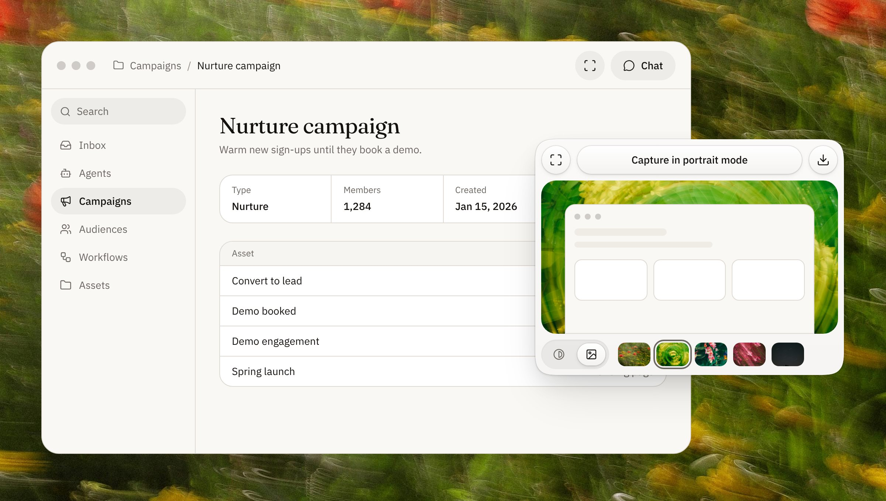
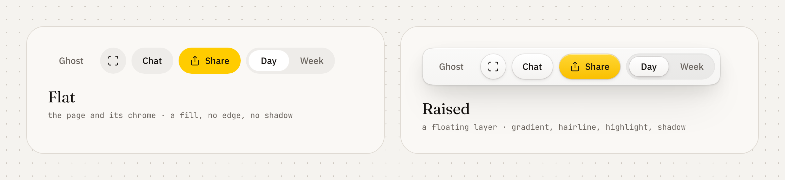
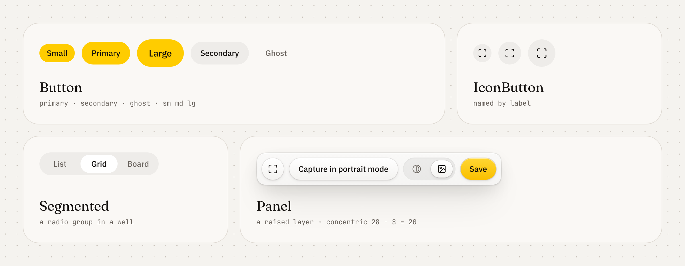
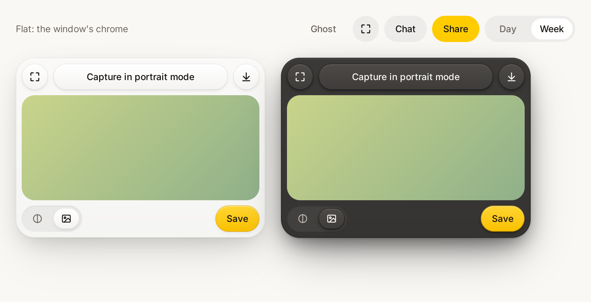

<h1 align="center">Sunbeam</h1>

<p align="center">
  AstraFoundry's design system for the web and for native apps drawn by MyGo.<br />
  Warm ink on paper, one yellow, flat chrome and raised layers.
</p>

<p align="center">
  <a href="LICENSE"></a>
  <a href="https://github.com/AstraFoundry/design/actions/workflows/ci.yml"></a>
  <a href="https://www.npmjs.com/package/@astrafoundry/design"></a>
  <a href="https://pkg.go.dev/github.com/AstraFoundry/design/packages/mygo/sunbeam"></a>
</p>

<p align="center">
  <a href="packages/web">Web</a>
  ·
  <a href="packages/mygo">MyGo</a>
  ·
  <a href="packages/web/skills/sunbeam/SKILL.md">Specification</a>
  ·
  <a href="packages/web/DESIGN.md">DESIGN.md</a>
  ·
  <a href="CONTRIBUTING.md">Contributing</a>
</p>

<p align="center">
  <picture>
    <source media="(prefers-color-scheme: dark)" srcset="docs/images/hero-dark.jpg" />
    
  </picture>
</p>

## Quiet, warm and precise

Sunbeam is one design language with two implementations that share every token: React components and Tailwind v4 tokens for the web, and a Go package for native windows that [MyGo](https://github.com/egoist/mygo) draws on the GPU.

- **One source of truth.** Every color, radius, space and text style lives in [`sunbeam.json`](packages/web/tokens/sunbeam.json). The CSS, the specification's tables, DESIGN.md and the Go tokens are generated from it, and the tests fail when any of them drifts.
- **Two materials, one rule.** The page and its chrome are flat. Layers that float above them are raised, along with everything inside them. Components pick the material up from their layer, so you never choose it by hand.
- **Made to be read by agents.** The [Sunbeam skill](packages/web/skills/sunbeam/SKILL.md) and [DESIGN.md](packages/web/DESIGN.md) state the rules for people and coding agents alike.
- **Accessible by default.** Keyboard focus is always visible, segmented controls are real radio groups, and motion respects reduced-motion settings on both platforms.

## Packages

| Package                          | For                                                                       | Install                                               |
| -------------------------------- | ------------------------------------------------------------------------- | ----------------------------------------------------- |
| [`packages/web`](packages/web)   | Next.js and React sites: Tailwind v4 tokens, components, mock demo stages | `npm install @astrafoundry/design`                    |
| [`packages/mygo`](packages/mygo) | Native apps with MyGo's `ui` package: the same tokens and components      | `go get github.com/AstraFoundry/design/packages/mygo` |
| [`examples`](examples)           | Taste examples that consume the web package (not published)               |                                                       |

## Materials: flat and raised

<p align="center">
  <picture>
    <source media="(prefers-color-scheme: dark)" srcset="docs/images/materials-dark.png" />
    
  </picture>
</p>

A layer has one material, and every control in it takes that material. The material follows the layer, not the component: the same button is flat in a toolbar and raised in a panel.

|                  | Flat                                                    | Raised                                                                                          |
| ---------------- | ------------------------------------------------------- | ----------------------------------------------------------------------------------------------- |
| Where            | The page and its chrome: title bars, toolbars, sidebars | A floating layer (panel, popover, menu, dialog) and every control in it                         |
| Control          | One translucent fill, with no edge and no shadow        | A faint top-to-bottom gradient, a translucent hairline, a 1px top highlight and layered shadows |
| Track of choices | A fill, with the choice made as a solid thumb           | A recessed well, with the choice made as its one raised face                                    |
| Dark mode        | Translucent white fills                                 | Faces lighter gray than the panel, with near-black edges and half-black shadows                 |

Corners nest concentrically: a panel's 28px radius minus its 8px inset is the 20px radius of the 40px pills inside it. Where the platform supports it, corners curve continuously, using `corner-shape: squircle` on the web and MyGo's continuous corners on macOS.

## Components

<p align="center">
  <picture>
    <source media="(prefers-color-scheme: dark)" srcset="docs/images/components-dark.png" />
    
  </picture>
</p>

| Component    | Web (`@astrafoundry/design/ui`)    | MyGo (`sunbeam`)                                       |
| ------------ | ---------------------------------- | ------------------------------------------------------ |
| Button       | `Button`, `LinkButton`             | `Button`, `PrimaryButton`, `GhostButton`               |
| Icon button  | `IconButton`                       | `IconButton`                                           |
| Segmented    | `Segmented`                        | `Segmented`, `SegmentedIcons`                          |
| Panel        | `Panel`                            | `Panel`                                                |
| Layers       | `data-material="raised"`           | `Layer(sunbeam.Raised, …)`                             |
| Own controls | `material-face`, `material-well` … | `Face`, `PrimaryFace`, `Thumb`, `Well`, `PanelSurface` |
| Scheme       | `.dark`, `.light`, `Panel scheme`  | `Use`, `Scheme`                                        |

The web package also ships the site shell (`SiteHeaderShell`, `SiteFooterShell`, `LocaleSwitch`), mock product demos on photographs (`FloatingStage`, `AppWindow`, `BackdropCard`), and vendored [beUI](https://beui.dev) motion components.

## Native, with MyGo

<p align="center">
  <picture>
    <source media="(prefers-color-scheme: dark)" srcset="docs/images/mygo-gallery-dark.png" />
    
  </picture>
</p>

This image is drawn by MyGo itself, not a browser: the package's own gallery, rendered headlessly. The Go components follow the same rules as the web ones:

```go
func (app *App) view(c *ui.Context) {
	sunbeam.Use(c) // Sunbeam's colors, light or dark as the system is
	sunbeam.Button(c, "Chat") // flat: the window's chrome
	sunbeam.Scheme(c, true, func() { // a dark panel, whatever the window
		sunbeam.Panel(c, func() { // raised, and everything in it
			if sunbeam.Button(c, "Capture in portrait mode").Clicked() {
				app.capture()
			}
		})
	})
}
```

## Quick start on the web

```sh
npm install @astrafoundry/design
```

```css
@import "tailwindcss";
@import "@astrafoundry/design/styles.css";
```

```tsx
import { Button, IconButton, Panel, Segmented } from "@astrafoundry/design/ui";

<Panel scheme="dark">
  <IconButton label={copy.download}>
    <Download />
  </IconButton>
  <Button variant="secondary">{copy.capture}</Button>
  <Segmented label={copy.view} value={view} onValueChange={setView} options={views} />
</Panel>;
```

See the [web package](packages/web/README.md) for fonts, themes, mock demos, backdrops and publishing, and the [MyGo package](packages/mygo/README.md) for the Go API.

## For AI agents

Give your coding agent the specification, and it will build in Sunbeam on either platform:

```sh
npx skills add https://github.com/AstraFoundry/design/tree/main/packages/web/skills/sunbeam
```

| File                                               | Contents                                                                                          |
| -------------------------------------------------- | ------------------------------------------------------------------------------------------------- |
| [`SKILL.md`](packages/web/skills/sunbeam/SKILL.md) | Principles, tokens, type, materials, backdrop cards, figures, motion, copy and a review checklist |
| [`DESIGN.md`](packages/web/DESIGN.md)              | Sunbeam in the open DESIGN.md format, linted for WCAG AA contrast                                 |
| [`sunbeam.json`](packages/web/tokens/sunbeam.json) | Every token value                                                                                 |

## Run locally

Node.js 24, the pinned pnpm and Go 1.27 are required (`GOTOOLCHAIN=auto` downloads Go 1.27 for you).

```sh
git clone https://github.com/AstraFoundry/design.git
cd design
pnpm install
pnpm mygo:gallery   # open the native gallery
```

```sh
pnpm check          # web: typecheck, lint, test, build · Go: gofmt, vet, test
pnpm tokens:build   # after editing sunbeam.json
pnpm readme:images  # re-render the images in this README (needs Playwright's Chromium)
```

## Contributing

| Location                 | Purpose                                                            |
| ------------------------ | ------------------------------------------------------------------ |
| `packages/web/tokens/`   | `sunbeam.json` (the source) and the generated and hand-written CSS |
| `packages/web/src/ui/`   | Web components                                                     |
| `packages/web/src/mock/` | Mock demo stages and backdrops                                     |
| `packages/mygo/sunbeam/` | MyGo components and the generated Go tokens                        |
| `packages/web/skills/`   | The Sunbeam specification                                          |
| `docs/images/`           | The README's images, rendered by `pnpm readme:images`              |

A component that both platforms have keeps the same name, rules and tokens in each, so change it in both. Read [CONTRIBUTING.md](CONTRIBUTING.md) before opening a pull request.

## Release

- `@astrafoundry/design`: push a `vX.Y.Z` tag, and the release workflow publishes it to npm.
- The Go module: push a `packages/mygo/vX.Y.Z` tag.

## License

MIT. Photographs and vendored beUI keep their own terms; see [NOTICE.md](packages/web/NOTICE.md).
