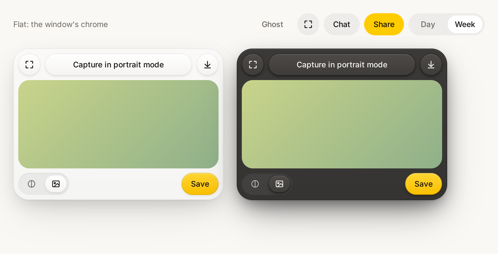

# Sunbeam for MyGo

Sunbeam, the AstraFoundry design system, for native apps whose interface [MyGo](https://github.com/egoist/mygo) draws itself (package `github.com/egoist/mygo/ui`). It is the twin of the web package [`@astrafoundry/design`](../web/README.md): the same tokens, generated from the same `sunbeam.json`, and the same components following the same rules.

<p align="center">
  <picture>
    <source media="(prefers-color-scheme: dark)" srcset="https://raw.githubusercontent.com/AstraFoundry/design/main/docs/images/mygo-gallery-dark.png" />
    
  </picture>
</p>

```sh
go get github.com/AstraFoundry/design/packages/mygo
```

It needs Go 1.27 and MyGo 0.8, as MyGo does.

## Use

```go
import (
	"github.com/AstraFoundry/design/packages/mygo/sunbeam"
	"github.com/egoist/mygo/ui"
)

func (app *App) view(c *ui.Context) {
	sunbeam.Use(c) // Sunbeam's colors, light or dark as the system is
	ui.Column(c).Fill().Padding(24).Gap(24).Children(func() {
		ui.Row(c).Gap(8).Children(func() {
			sunbeam.Button(c, "Chat") // flat: the window's chrome
		})
		sunbeam.Scheme(c, true, func() { // a dark panel, whatever the window
			sunbeam.Panel(c, func() { // raised, and everything in it
				if sunbeam.Button(c, "Capture in portrait mode").Clicked() {
					app.capture()
				}
				sunbeam.SegmentedIcons(c, &app.background, icons, []string{"Theme", "Image"}).Label("Background")
			}).Width(380)
		})
	})
}
```

| API                                                    | What                                                                                     |
| ------------------------------------------------------ | ---------------------------------------------------------------------------------------- |
| `Use`, `Theme`, `Scheme`                               | Theme the window, or a part of it, with Sunbeam, so MyGo's own widgets match.            |
| `Colors`, `Light`, `Dark`, `Palette`                   | The palette of the part being built, and every semantic, art, figure and material token. |
| `Ink50`…`Ink900`, `Yellow100`…, `Substrate…`           | The scales and the substrate.                                                            |
| `Radius…`, `Space…`, `Type…`                           | Radii, spacing and text styles, in DIPs.                                                 |
| `Button`, `PrimaryButton`, `GhostButton`, `IconButton` | Buttons that take their layer's material.                                                |
| `Panel`                                                | A floating raised layer.                                                                 |
| `Segmented`, `SegmentedIcons`                          | A well of choices whose chosen segment is its one raised face.                           |
| `Layer`, `Current`, `Flat`, `Raised`                   | Open a layer of a material, and read the current one.                                    |
| `Face`, `PrimaryFace`, `Thumb`, `Well`, `PanelSurface` | The materials for elements of your own.                                                  |

## Materials

A layer has one material, and everything in it takes that material. The window and its chrome are **flat**: a control is a fill with no edge, gradient or shadow. A layer that floats above them, as a `Panel`, is **raised**, and so is every control in it: a faint top-to-bottom gradient, a translucent 1-DIP edge, a 1-DIP white highlight inside its top edge and layered shadows. In the dark a raised face is a lighter gray than the panel under it, and its shadows are half black. Inside a raised layer a track of choices is recessed, and the choice made is its one raised face. The [Sunbeam skill](../web/skills/sunbeam/SKILL.md#4-materials) has the full rules, the same on both platforms.

Corners curve continuously where MyGo draws them so (macOS) and are quarter circles elsewhere. A `Panel`'s `RadiusTile` less its `SpaceTileInset` is the 20-DIP radius of the 40-DIP pills inside it, so corners nest concentrically.

Layers are tracked while a view builds, on the main thread, where MyGo builds every view.

## Tokens

`sunbeam/tokens_gen.go` is generated from [`packages/web/tokens/sunbeam.json`](../web/tokens/sunbeam.json) by `pnpm tokens:build` at the repository root; do not edit it. The web package's tests fail when it drifts.

## Gallery and tests

```sh
go run ./examples/gallery    # the components in both materials, light and dark
go test ./...                # headless, with ui.NewTester
SUNBEAM_SNAPSHOT=/tmp go test ./examples/gallery   # also writes the gallery as PNGs
```

## Releasing

The module is versioned by tags of the form `packages/mygo/vX.Y.Z` on this repository; there is nothing to publish.
