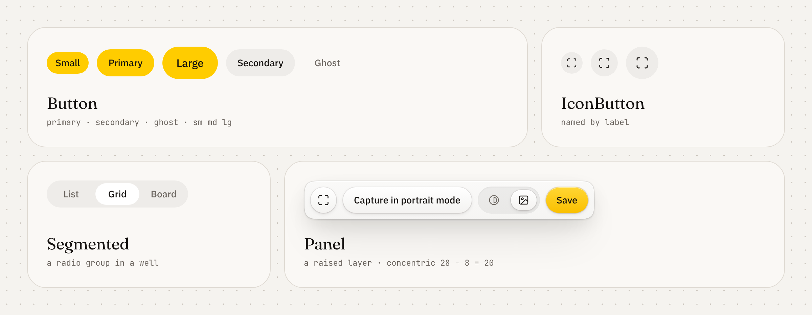
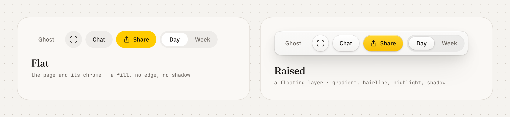

# @astrafoundry/design

The shared visual layer of AstraFoundry sites: Sunbeam tokens for Tailwind v4, vendored beUI motion components, presentation primitives, and the floating mock UI stage (product demos on soft, motion-blurred photographs).

This is the web package of the [Sunbeam monorepo](../../README.md); its twin for native apps drawn by MyGo is [`packages/mygo`](../mygo/README.md), built from the same tokens. `@astrafoundry/design` is the versioned package sites install. Product sites must not copy these files.

<p align="center">
  <picture>
    <source media="(prefers-color-scheme: dark)" srcset="https://raw.githubusercontent.com/AstraFoundry/design/main/docs/images/components-dark.png" />
    
  </picture>
</p>

The package contains no user-facing copy. Every label, title and accessible name comes in through props from the site's dictionary. See [CONTRIBUTING.md](CONTRIBUTING.md).

## Contents

| Path                   | What                                                                                                                                                                                                                                    |
| ---------------------- | --------------------------------------------------------------------------------------------------------------------------------------------------------------------------------------------------------------------------------------- |
| `tokens/sunbeam.json`  | Token values, the single source for both platforms. `tokens/sunbeam.css`, the skill's token tables, the DESIGN.md front matter and the MyGo package's `tokens_gen.go` are generated from it (`pnpm tokens:build`; tests fail on drift). |
| `DESIGN.md`            | Sunbeam in the open DESIGN.md format (published at `/design.md`); see [DESIGN.md](#designmd).                                                                                                                                           |
| `skills/sunbeam/`      | `SKILL.md`, the Sunbeam specification as an Agent Skill (published at `/design` and `/design/skill.md`).                                                                                                                                |
| `tokens/sunbeam.css`   | `:root` / `.dark` semantic tokens, ink and yellow scales, the always-dark substrate, warm two-layer shadows.                                                                                                                            |
| `tokens/theme.css`     | Tailwind v4 `@theme inline` mapping, `@custom-variant dark`, keyframes and utilities; `@source` for the package itself.                                                                                                                 |
| `tokens/material.css`  | The flat and raised materials: layer toggles, `material-*` utilities and `rounded-continuous-*` corners; see [Materials](#materials).                                                                                                   |
| `tokens/base.css`      | Document defaults: body colors and font, selection, focus ring, reduced motion.                                                                                                                                                         |
| `fonts/cjk.css`        | Font stacks with Chinese (`:lang(zh)`) and Japanese (`:lang(ja)`) fallbacks.                                                                                                                                                            |
| `styles.css`           | All of the above, in order.                                                                                                                                                                                                             |
| `src/ui`               | `Button`, `IconButton`, `LinkButton`, `Panel`, `Segmented`, `Container`, `Reveal`, `Brand`, `BrandMark`, `ChatMessage`, `SiteHeaderShell`, `SiteFooterShell`, `LocaleSwitch`, `LocaleList`.                                             |
| `src/mock`             | `Backdrop`, `BackdropCard`, `FloatingStage`, `AppWindow`, `DesktopWindow`, `MockFrame`, `useStepTimeline`, `useInViewOnce`.                                                                                                             |
| `src/beui`             | Vendored beUI. See [`docs/beui.md`](docs/beui.md).                                                                                                                                                                                      |
| `assets/`              | Backdrop manifest, originals and the image build script.                                                                                                                                                                                |
| `../../examples/taste` | A consumer of this package. Add further taste examples beside it; they are not published.                                                                                                                                               |

## Use in a Next.js site

Install the published package:

```sh
npm install @astrafoundry/design
```

```json
{ "dependencies": { "@astrafoundry/design": "0.1.1" } }
```

`0.1.1` is the package version in this repository. The [release workflow](../../.github/workflows/release.yml) publishes it to GitHub Packages (`https://npm.pkg.github.com`) by running `make publish` when a `v*.*.*` tag is pushed. The workflow authenticates with `GITHUB_TOKEN`. Install from that registry:

```sh
npm install @astrafoundry/design --registry https://npm.pkg.github.com
```

GitHub Packages asks for a token with `read:packages` even for this public package. A site maps the scope in its committed `.npmrc` and keeps the token in the user-level config, because pnpm ignores tokens in a project `.npmrc`:

```ini
# .npmrc (committed)
@astrafoundry:registry=https://npm.pkg.github.com
```

```sh
pnpm config set "//npm.pkg.github.com/:_authToken" "<token with read:packages>"
```

In GitHub Actions, `actions/setup-node` with `registry-url: https://npm.pkg.github.com` and `scope: "@astrafoundry"` writes that line; pass the job's `GITHUB_TOKEN` as `NODE_AUTH_TOKEN` and grant `packages: read`.

To try a change before it is published, depend on this git repository instead of copying the source. The package lives in `packages/web`, which pnpm reaches with `path:`:

```json
{
  "dependencies": {
    "@astrafoundry/design": "github:AstraFoundry/design#<commit>&path:packages/web"
  }
}
```

Peer dependencies: `react`, `react-dom` 19, `motion` 13, `tailwindcss` 4; optionally `next-themes` (theme toggle), `shiki` (code blocks) and `sharp` (backdrop build). GitHub Packages drops `peerDependenciesMeta` from the registry metadata, so pnpm installs the optional three as well when the package comes from there.

**Transpile.** Git installs and this repository resolve TypeScript sources. The npm tarball's `publishConfig` points `exports` at compiled ESM in `dist/`. Add the package to `transpilePackages` either way:

```ts
// next.config.ts
const config = { transpilePackages: ["@astrafoundry/design"] };
export default config;
```

**Styles.** Import Tailwind, then the package, in the global stylesheet. `theme.css` registers the package's own sources with `@source`, so its classes are generated without extra configuration.

```css
@import "tailwindcss";
@import "@astrafoundry/design/styles.css";
```

**Fonts.** Load the Latin faces with `next/font` and expose them as CSS variables; the CJK fallbacks apply by `<html lang>`.

```tsx
const display = Fraunces({ subsets: ["latin"], variable: "--font-latin-display" });
const sans = IBM_Plex_Sans({
  subsets: ["latin"],
  weight: ["300", "400", "500"],
  variable: "--font-latin-sans",
});
const mono = JetBrains_Mono({ subsets: ["latin"], variable: "--font-latin-mono" });
// <html lang={tag} className={`${display.variable} ${sans.variable} ${mono.variable}`}>
```

**Theme.** Dark mode is the `.dark` class on `<html>` (for example `next-themes` with `attribute="class"`). Components use semantic utilities only and never write `dark:`. A part of the page can take the other scheme with `.dark` or `.light` on its root, as a dark panel over a light page.

## Materials

<p align="center">
  <picture>
    <source media="(prefers-color-scheme: dark)" srcset="https://raw.githubusercontent.com/AstraFoundry/design/main/docs/images/materials-dark.png" />
    
  </picture>
</p>

A layer has one material, and every control in it takes that material. The page and its chrome are **flat**: a control is a translucent fill with no edge, gradient or shadow. A layer floating above them is **raised**: its controls get a faint top-to-bottom gradient, a translucent 1px edge, a 1px highlight inside the top edge and layered warm shadows. In dark mode a raised face is a lighter gray than the panel under it, with half-black shadows. The [skill](skills/sunbeam/SKILL.md#4-materials) has the full rules.

```tsx
import { Button, IconButton, Panel, Segmented } from "@astrafoundry/design/ui";

<header className="flex gap-2">
  <Button variant="secondary">{copy.chat}</Button> {/* flat */}
</header>
<Panel scheme="dark" className="w-96">
  <div className="flex gap-2">
    <IconButton label={copy.fullScreen}><Expand /></IconButton> {/* raised */}
    <Button variant="secondary" className="grow">{copy.capture}</Button>
  </div>
  <Segmented label={copy.background} value={mode} onValueChange={setMode} iconOnly options={modes} />
</Panel>
```

- `Button`, `LinkButton` and `IconButton` (`primary` and `secondary`) and `Segmented` follow their layer. `Panel` opens a raised layer (`material="flat"` for a card that stays on the page); `data-material="raised"` or `"flat"` on any element does the same for markup of your own.
- `material-face`, `material-face-primary`, `material-thumb` (the chosen segment) and `material-well` (a track of choices) style your own controls by their layer; `material-panel` is the surface of a raised layer.
- `rounded-continuous-tile` (or any radius, as `rounded-continuous-3xl`) curves corners continuously where the browser supports `corner-shape: squircle`, growing the radius by 1.5 to keep the corner as soft, and falls back to a circular corner elsewhere. Use it on panels and cards; pills stay `rounded-full`.
- A `.dark` or `.light` part inside a layer keeps that layer's material: the layer toggles carry no colors, which resolve at each control.
- The `dark:` variant keys off `.dark` ancestors only, so vendored beUI under a `.light` part inside a dark page still takes its dark styles.

## Components

```tsx
import { Brand, Container, LinkButton, SiteHeaderShell } from "@astrafoundry/design/ui";
import {
  AppWindow,
  FloatingStage,
  useInViewOnce,
  useStepTimeline,
} from "@astrafoundry/design/mock";
import { TextReveal } from "@astrafoundry/design/beui/motion/text-reveal";
```

- `LinkButton` renders a plain anchor; pass the site's locale-aware link as `as={AppLink}`. `SiteFooterShell` takes the same through `linkAs`.
- `SiteHeaderShell` takes `brand`, `nav`, `actions` and a `mobileMenu(close)` render function; `menuLabels` is required with a mobile menu.
- `LocaleSwitch` and `LocaleList` take the label and the list of `{ locale, tag, name, href, current }` links; switching locale is a full page load.

### Mock demos

A demo is a mock window on a `FloatingStage`, driven by a scripted timeline that starts when the reader scrolls to it:

```tsx
"use client";

const DELAYS = [900, 1400, 1100] as const;

export function ProductDemo({ label }: { label: string }) {
  const [ref, inView] = useInViewOnce<HTMLDivElement>(0.2);
  const { step } = useStepTimeline(DELAYS, inView);
  return (
    <FloatingStage backdrop="field" priority>
      <div ref={ref}>
        <AppWindow label={label} className="h-[520px]">
          {/* product-specific mock content keyed off `step` */}
        </AppWindow>
      </div>
    </FloatingStage>
  );
}
```

Rules the primitives enforce or expect:

- Mock surfaces are solid (`bg-card`, hairline border, `shadow-5`) with real hierarchy. No glass, glow or colored gradients. Text set over the photo gets the ink scrim only (`FloatingStage scrim="top" | "bottom"`).
- `AppWindow`, `DesktopWindow` and `MockFrame` announce the demo as one image (`role="img"` with the required `label`) and make its contents `inert`. Interactive controls such as a replay button go outside the window.
- `useStepTimeline` waits for `running` (pair it with `useInViewOnce`) and, under `prefers-reduced-motion`, reports the final step immediately and schedules nothing. `Reveal` renders in place under reduced motion.
- Product-specific mocks (Arion's dictation pill, Telo's chat layout, Lyra's workspace) live in the consuming site's widgets, not here.

### Backdrop cards

`BackdropCard` is Sunbeam's signature surface: a photograph, the mark and wordmark top-left, one solid focus surface (`bg-substrate-focus`, white in both modes) flanked by tint chips that bleed off the edges, a status line under it and a muted caption bottom-left on the same inset as the mark. The wordmark (`wordmarkAs`) and caption are real text; the focus row is `inert` and hidden from assistive technology. Pass `played={inView}` to play the focus row's entrance once, and `guides` to draw the inset, the focus axis and the numbered zones.

```tsx
const [ref, inView] = useInViewOnce<HTMLDivElement>(0.4);
<div ref={ref}>
  <BackdropCard
    backdrop="gladiolus"
    wordmark={copy.name}
    mark={<BrandMark />}
    before={{ title: copy.token, detail: "--yellow-500" }}
    focus={copy.message}
    after={{ title: copy.export }}
    status={copy.status}
    caption={copy.caption}
    played={inView}
  />
</div>;
```

## Agent skill

`skills/sunbeam/SKILL.md` is the Sunbeam specification for people and coding agents: principles, tokens, type, materials, backdrop cards, feature tiles, 3D demonstration figures, motion, copy and a review checklist. Its token tables are generated; edit the prose, then run `pnpm tokens:build`. Install it with the skills CLI (`npx skills add https://github.com/AstraFoundry/design/tree/main/packages/web/skills/sunbeam`), download it from `https://astrafoundry.si/design/skill.md`, or read `skills/sunbeam/SKILL.md` from the installed package.

## DESIGN.md

`DESIGN.md` is Sunbeam in the open [DESIGN.md](https://github.com/google-labs-code/design.md) format, for any agent or design tool that reads it. `pnpm tokens:build` writes its front matter from `tokens/sunbeam.json`: colors as hex with `{colors.x}` aliases, a `dark-` twin of every semantic color, the `typography`, `rounded`, `spacing` and `components` groups, and a derived `-dark` variant of every component that uses a mode-dependent color. The body is written by hand in the format's section order. `pnpm test` runs the official linter (`@google/design.md`) and fails on any error or warning, including a component pair below WCAG AA contrast. Fetch it with `curl -fsSL https://astrafoundry.si/design.md -o DESIGN.md`, or import `@astrafoundry/design/DESIGN.md`.

## Backdrops

`assets/backdrops.json` lists every backdrop: `id`, `status`, `source` (original under `assets/`), `sourceUrl`, `author`, `license`, `focalPoint`, `dominantColor`, `usage`, `notes`. Originals are committed as optimized JPEGs (about 1 MB at most, at least 2400 px wide) in `assets/source/`; nothing is hotlinked at runtime.

Render a site's images into its public directory:

```sh
# in this repository (paths are relative to where you run the command)
pnpm assets:build <outDir>

# in another repository, with sharp installed
pnpm exec astrafoundry-backdrops public/backdrops
```

For each `ready` entry it writes `<id>/wide-1200`, `wide-2400` (1.62:1) and `tall-900` (2:3) as AVIF and WebP, plus `desktop.jpg` (800 × 1000, under 200 KB) for native apps. Crops are centered on the focal point. In this repository the script also regenerates `src/mock/backdrops.generated.ts` (blur placeholder, average color, object position) and the manifest's `dominantColor`; commit those with any manifest or original change. The build fails, naming the entry, when a ready original is missing or too small. `pending-source` entries are skipped with a warning.

`<Backdrop id="field" />` then renders a decorative `<picture>` (portrait crop on narrow portrait screens, AVIF before WebP) over the placeholder, served from `/backdrops/<id>/` (`basePath` to change). Only ready ids type-check. `backdropCredits` lists every entry's source, author and license for a credits page.

| id             | Status         | Use          | Source                                                                                                                                  |
| -------------- | -------------- | ------------ | --------------------------------------------------------------------------------------------------------------------------------------- |
| `field`        | ready          | Lyra         | Lyra's sign-in photo (`lyra` `apps/web/public/brand/login-hero.jpg`); photographer not recorded                                         |
| `arion-meadow` | pending-source | Arion        | [Unsplash `FTbxkhiPPKM`](https://unsplash.com/photos/motion-blurred-flowers-in-meadow-FTbxkhiPPKM)                                      |
| `telo`         | ready          | Telo         | [Unsplash `IpcLnWfa4Mo`](https://unsplash.com/photos/yellow-flowers-and-green-leaves-swirl-in-motion-IpcLnWfa4Mo), DL314 Lin            |
| `brand-hero`   | ready          | astrafoundry | [Unsplash `0EggWy3ac68`](https://unsplash.com/photos/star-trails-over-silhouetted-trees-at-night-0EggWy3ac68), Travis Fish              |
| `gladiolus`    | ready          | design       | [Unsplash `Jk_9EwoLXnY`](https://unsplash.com/photos/pink-gladiolus-flowers-with-green-foliage-in-motion-Jk_9EwoLXnY), Eugene Golovesov |
| `pink-motion`  | ready          | design       | [Unsplash `DjZ5xwr1cq4`](https://unsplash.com/photos/pink-flowers-with-motion-blur-effect-DjZ5xwr1cq4), Raphael Nicolas                 |

To finish a pending entry: save the original as `assets/source/<id>.jpg`, fill in `author`, `license` and `focalPoint`, set `status` to `ready`, run `assets:build`, and commit the original, manifest and generated module together.

## Scripts

```sh
pnpm build         # tsc to dist/
pnpm typecheck
pnpm lint
pnpm test          # token, skill, DESIGN.md and Go drift check + vitest
pnpm tokens:build  # regenerate tokens/sunbeam.css, the skill's token tables, DESIGN.md and ../mygo/sunbeam/tokens_gen.go
pnpm assets:build <outDir>
pnpm check
make login         # npm login for the @astrafoundry scope
make whoami
make publish       # whoami, pnpm check, then publish to npm (from the repository root)
```

To release from CI, bump `version` in this package.json, merge, and push a matching tag. Actions publishes with its own `GITHUB_TOKEN`; do not add an npmjs token:

```sh
git tag v0.1.1 && git push origin v0.1.1
```

The [release workflow](../../.github/workflows/release.yml) refuses a tag that does not match the version, runs `make publish`, then creates the GitHub release. Run it by hand from the Actions tab for a dry run. Where a tag cannot be pushed, run it by hand on `main` with `publish` checked: it publishes the version in this package.json, then creates the `vX.Y.Z` tag and the GitHub release (and refuses a version whose tag exists).

## Publishing

`publishConfig.access` is `public` and `publishConfig.exports` swaps the entry points to `dist/` on npm. `files` ships `dist`, `src` (for Tailwind's `@source` and source maps), tokens, fonts, the manifest, originals, the skill, DESIGN.md and the backdrop script. Examples are not part of the tarball.

The project [`.npmrc`](.npmrc) sends the `@astrafoundry` scope to GitHub Packages. `make login` writes a GitHub personal access token (`write:packages`) to your user npm config. Do not commit a token.

```sh
make login     # npm login --scope=@astrafoundry --registry=https://npm.pkg.github.com
make whoami    # the logged-in GitHub Packages user
make publish   # confirm login, run pnpm check, then pnpm publish --access public
```

`make publish` keeps npm's git checks on a local publish. When `CI` is set, as it is on GitHub Actions, it passes `--no-git-checks` so a tag checkout can publish. Pushing a `v*.*.*` tag runs [`.github/workflows/release.yml`](.github/workflows/release.yml), which runs `make publish` with `GITHUB_TOKEN` for `https://npm.pkg.github.com`.
